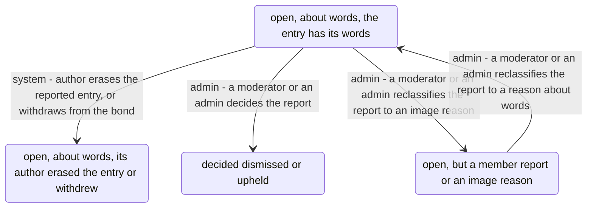
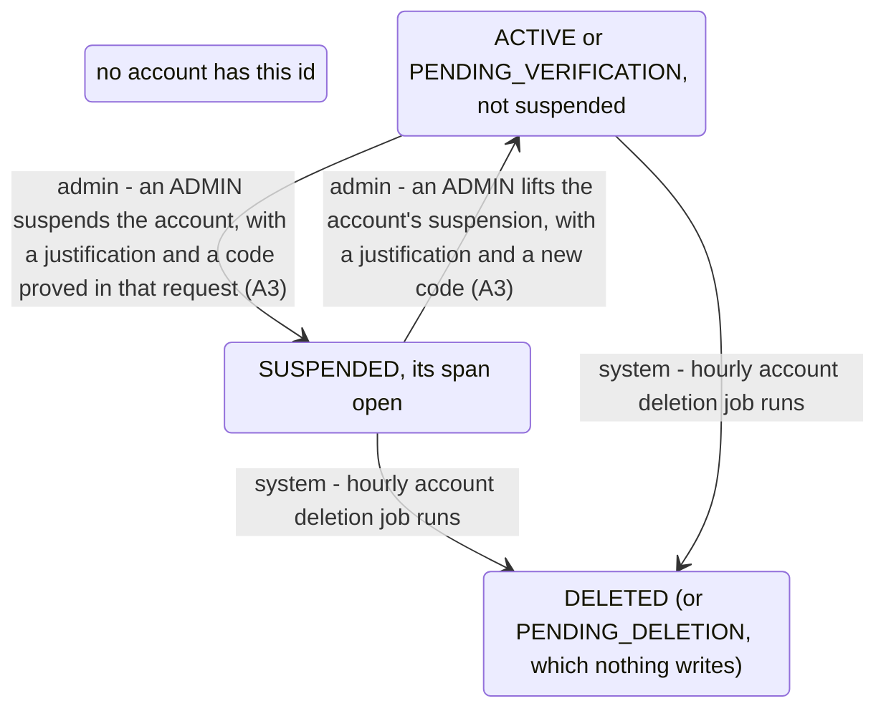

<!-- Generated by scripts/state-map-generate from docs/state-map/data. Do not edit. -->

# The admin machine

Describes `main @ 5839d47`. How to read this: [README](README.md).

Every answer of every endpoint, with its cause and how to try it: [endpoints](endpoints.md)

Each region below has its own diagram. Each arrow says who acts: you, your partner, the system or an admin. Refusals are not drawn; they are in the tables. Grey means designed or only partly built, and no endpoint reaches it.

## A report, as an ADMIN reading its entry's words finds it (the console, A5, ADR-0064)

### Happens without you

| In | What happens | Who | When | Leads to | Why | Evidence |
|---|---|---|---|---|---|---|
| `OPEN_WORDS` | an ADMIN asks to read the reported entry's words, with a justification and a code proved in that request | admin | the request passes the role, the justification and the code (outcome SHOWN) | `OPEN_WORDS` | The entry's words and its bond-day's date are shown in the POST's own response, never cached. The read is one ENTRY_TEXT_READ row (SUCCEEDED) and one WORDS_READ row in the report's log, committed with it; the report stays open. A MODERATOR or SUPPORT never reaches this, a wrong code is the form again with nothing read, and every read needs a new code. | test |
| `OPEN_ERASED` | an ADMIN asks to read the reported entry's words, with a justification and a code proved in that request | admin | the same request (outcome ERASED) | `OPEN_ERASED` | No words: the page says its author erased the entry. The read is still audited (SUCCEEDED) and still logs WORDS_READ, because the act completed and read nothing. An open report does not hold the words from their author's erasure or withdrawal. | test |
| `DECIDED` | an ADMIN asks to read the reported entry's words, with a justification and a code proved in that request | admin | the same request (outcome NOT_OPEN) | `DECIDED` | Nothing is read: the report's page says it was already decided. The attempt is one ENTRY_TEXT_READ row (REFUSED) and no WORDS_READ row; the report is never read once decided. Not this row: a well-formed id that names no report. The port answers NOT_OPEN for it too, but only after the code has been proved and spent; the attempt is one ENTRY_TEXT_READ row (REFUSED) on the REPORT target, and the answer is the 404 page, since there is no report to show. | test |
| `OPEN_WORDS` | an ADMIN asks to read the reported entry's words, with a justification and a code proved in that request | admin | the reason the page showed is not the report's reason now (outcome STALE) | `OPEN_WORDS` | Nothing is read: someone reclassified the report after the page was loaded, so the admin is told to read it again. One ENTRY_TEXT_READ row (REFUSED), no WORDS_READ row. | test |
| `NOT_ABOUT_WORDS` | an ADMIN asks to read the reported entry's words, with a justification and a code proved in that request | admin | a member report, or a report whose reason is NON_CONSENSUAL or MINOR_SEXUAL_CONTENT (outcome NOT_ABOUT_WORDS) | `NOT_ABOUT_WORDS` | Nothing is read: the page says why (a member report has no entry; an image reason is reclassified first if its detail is about words). This keeps a read off any report that might concern child sexual abuse material. One ENTRY_TEXT_READ row (REFUSED), no WORDS_READ row. | test |
| `OPEN_WORDS` | the author erases the reported entry, or withdraws from the bond | system | at any time while the report is open | `OPEN_ERASED` | The author's right to erase wins: an open report does not hold the words. A withdrawn author's entry reads as erased even before the outbox has emptied the row, so that the admin does not read what the partner can no longer read. | test |
| `OPEN_WORDS` | a moderator or an admin decides the report | admin | dismissed, reclassified-and-upheld or upheld by a moderator or an admin (A2) | `DECIDED` | From then on no one may read its words: the rule needs an OPEN report. | test |
| `OPEN_WORDS` | a moderator or an admin reclassifies the report to an image reason | admin | a moderator or an admin picks NON_CONSENSUAL or MINOR_SEXUAL_CONTENT (A2) | `NOT_ABOUT_WORDS` | The reason decides: an image reason is never read as words, whatever its detail. | never-run |
| `NOT_ABOUT_WORDS` | a moderator or an admin reclassifies the report to a reason about words | admin | a report on an entry, whose detail shows it is about words (A2) | `OPEN_WORDS` | Reclassified first, then read: the one way an image-reason report's entry is ever read. | test |

## An account, as an ADMIN suspending it or lifting its suspension finds it (the console, A3, ADR-0066)

### Happens without you

| In | What happens | Who | When | Leads to | Why | Evidence |
|---|---|---|---|---|---|---|
| `LIVE` | an ADMIN suspends the account, with a justification and a code proved in that request (A3) | admin | outcome SUSPENDED | `SUSPENDED` | One ACCOUNT_SUSPENDED row, SUCCEEDED, the note as its justification and metadata {result, statusBefore, deletionPending}; committed with the act. The flash: "Suspended. They are signed out everywhere and cannot sign in. Their bonds are paused.", plus when a deletion the person asked for will run. Before the act, in order: the role (a MODERATOR or SUPPORT gets the 403 page and nothing is read), the id (not a UUID: the 404 page), the justification (ModerationNote: refused, the form again with 422 and no code spent) and the code (proved in this request: blank, the form asking for it; wrong or replayed, 401). Each act needs a code of its own. The answer is a 303 to the lookup with one line, never the note. | test |
| `SUSPENDED` | an ADMIN suspends the account, with a justification and a code proved in that request (A3) | admin | outcome ALREADY_SUSPENDED | `SUSPENDED` | Nothing changes, and the attempt is still one ACCOUNT_SUSPENDED row, REFUSED, result ALREADY_SUSPENDED: a spent code with no act beside it would read as a gap. Two admins at once: the second waits on the locks and gets this. | test |
| `SUSPENDED` | an ADMIN lifts the account's suspension, with a justification and a new code (A3) | admin | outcome LIFTED | `LIVE` | One ACCOUNT_UNSUSPENDED row, SUCCEEDED. The status the account earned (ACTIVE if verified, else PENDING_VERIFICATION); the span closes; no session comes back. The flash: "Suspension lifted. They can sign in again; their bonds take entries again now." | test |
| `LIVE` | an ADMIN lifts the account's suspension, with a justification and a new code (A3) | admin | outcome NOT_SUSPENDED | `LIVE` | Nothing changes; one ACCOUNT_UNSUSPENDED row, REFUSED, result NOT_SUSPENDED. "This account is not suspended. Nothing changed." | test |
| `GONE` | an ADMIN suspends the account, with a justification and a code proved in that request (A3) | admin | outcome GONE | `GONE` | A deleted account (or PENDING_DELETION, which nothing writes) cannot be suspended; one REFUSED row, result GONE. "This account was deleted. There is nothing to suspend." | test |
| `GONE` | an ADMIN lifts the account's suspension, with a justification and a new code (A3) | admin | outcome GONE | `GONE` | The same answer for a lift: one ACCOUNT_UNSUSPENDED row, REFUSED, result GONE. | test |
| `NO_ACCOUNT` | an ADMIN suspends the account, with a justification and a code proved in that request (A3) | admin | outcome NO_SUCH_ACCOUNT | `NO_ACCOUNT` | A well-formed id that names nobody: the admin 404 page, not a redirect, after the code has been proved and spent. One ACCOUNT_SUSPENDED row, REFUSED, with no target. | test |
| `NO_ACCOUNT` | an ADMIN lifts the account's suspension, with a justification and a new code (A3) | admin | outcome NO_SUCH_ACCOUNT | `NO_ACCOUNT` | The same for a lift: the 404 page, one ACCOUNT_UNSUSPENDED row, REFUSED, with no target. | test |
| `SUSPENDED` | the hourly account deletion job runs | system | a deletion the person asked for before the suspension falls due | `GONE` | A pending deletion is carried out on time, suspended or not: the right to erasure is the person's. The span outlives the erasure (dates and an anonymised id), so the partner's bond stays paused until the outbox ends it. | test |
| `LIVE` | the hourly account deletion job runs | system | a deletion the person asked for falls due | `GONE` | The account is erased as before A3; every later suspend or lift is GONE. | never-run |
