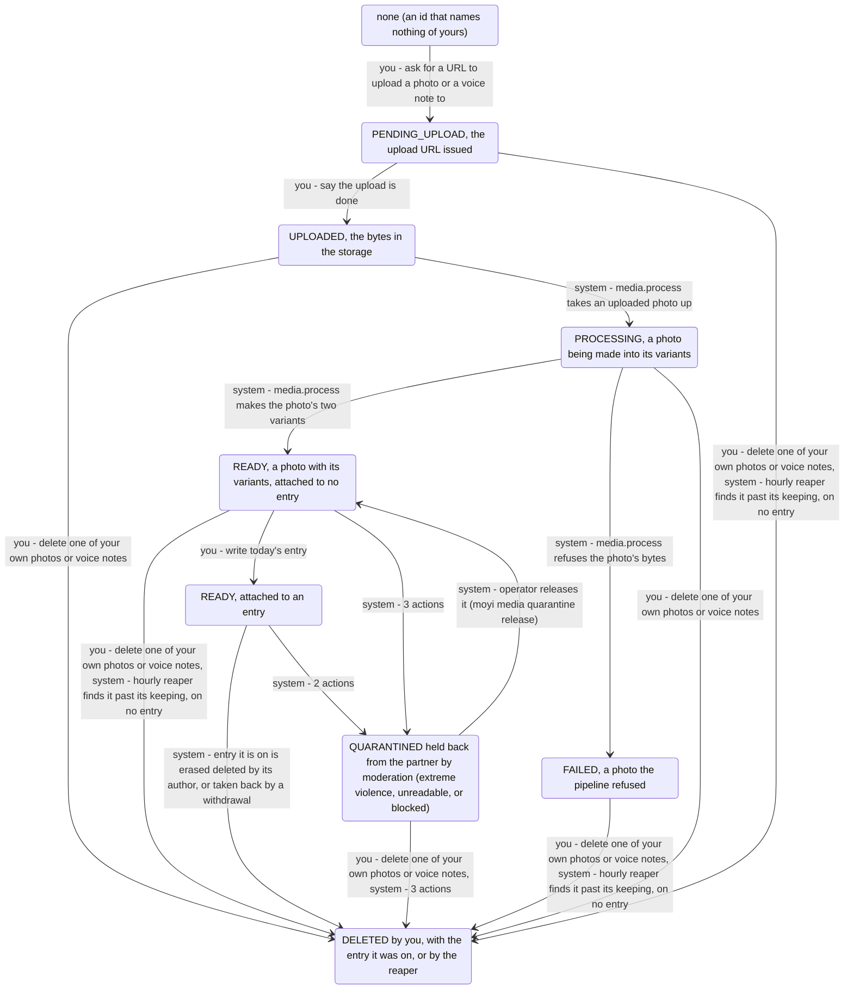

<!-- Generated by scripts/state-map-generate from docs/state-map/data. Do not edit. -->

# The media machine

Describes `main @ 5839d47`. How to read this: [README](README.md).

Every answer of every endpoint, with its cause and how to try it: [endpoints](endpoints.md)

Each region below has its own diagram. Each arrow says who acts: you, your partner or the system. Refusals are not drawn; they are in the tables. Grey means designed or only partly built, and no endpoint reaches it.

## The photo or voice note (one asset, named by its id; only the person who uploaded it can reach it by its id)

### Every action in every state

| Action | `NONE` | `PENDING_UPLOAD` | `UPLOADED` | `PROCESSING` | `READY` | `READY_ATTACHED` | `QUARANTINED` | `FAILED` | `DELETED` |
|---|---|---|---|---|---|---|---|---|---|
| ask for a URL to upload a photo or a voice note to `POST /media/upload-intent` | 201 → `PENDING_UPLOAD` (your email is verified, the declaration is accepted and a storage is configured) 403 `EMAIL_NOT_VERIFIED` (your email is not verified) 415 `MEDIA_TYPE_UNSUPPORTED` (the content type is not one its kind takes) 413 `MEDIA_QUOTA_EXCEEDED` (the declared size is over its kind's limit) 503 `MEDIA_STORAGE_UNAVAILABLE` (no storage is configured) | not reachable | not reachable | not reachable | not reachable | not reachable | not reachable | not reachable | not reachable |
| say the upload is done `POST /media/{mediaId}/complete` | 404 `NOT_FOUND` (your email is verified) 403 `EMAIL_NOT_VERIFIED` (your email is not verified) | 200 → `UPLOADED` (your email is verified, and the storage holds the declared bytes under the asset's key) 403 `EMAIL_NOT_VERIFIED` (your email is not verified) 409 `MEDIA_NOT_UPLOADED` (the storage holds nothing under the asset's key, or not the declared length and digest) 503 `MEDIA_STORAGE_UNAVAILABLE` (the storage cannot be reached) | 200 stays | 200 stays | 200 stays | 200 stays | 200 stays | 200 stays | 404 `NOT_FOUND` |
| read one of your own photos or voice notes `GET /media/{mediaId}` | 404 `NOT_FOUND` | 200 stays | 200 stays | 200 stays | 200 stays | 200 stays | 200 stays | 200 stays | 404 `NOT_FOUND` |
| delete one of your own photos or voice notes `DELETE /media/{mediaId}` | 404 `NOT_FOUND` | 204 → `DELETED` | 204 → `DELETED` | 204 → `DELETED` | 204 → `DELETED` | 409 `MEDIA_ATTACHED` | 204 → `DELETED` (it is on no entry) | 204 → `DELETED` | 404 `NOT_FOUND` |
| write today's entry `POST /bonds/{bondId}/entries` | 422 `VALIDATION_FAILED` | 422 `VALIDATION_FAILED` | 422 `VALIDATION_FAILED` | 422 `VALIDATION_FAILED` | 201 → `READY_ATTACHED` (your email is verified) 403 `EMAIL_NOT_VERIFIED` (your email is not verified) | 422 `VALIDATION_FAILED` | 422 `VALIDATION_FAILED` | 422 `VALIDATION_FAILED` | 422 `VALIDATION_FAILED` |

### You can

| In | Action | When | Leads to | Why | Evidence |
|---|---|---|---|---|---|
| `NONE` | ask for a URL to upload a photo or a voice note to | your email is verified, the declaration is accepted and a storage is configured | `PENDING_UPLOAD` | A new asset waits for its upload, and you get a URL that takes exactly the declared bytes straight to the storage, never through the API, for 15 minutes, with the headers the upload must carry. The URL is signed for the content type, the length and the SHA-256, so the storage refuses any other body. | smoke |
| `PENDING_UPLOAD` | say the upload is done | your email is verified, and the storage holds the declared bytes under the asset's key | `UPLOADED` | The storage holds the declared length (and the declared SHA-256, where the storage reports one), so the asset is uploaded and MediaUploaded is recorded for the pipeline, in one transaction. | smoke |
| `UPLOADED` | say the upload is done |  | stays | It is already complete. Completing again, under the same key or a new one, changes nothing and records no second event; the same key is answered as a replay. | test |
| `PENDING_UPLOAD` | read one of your own photos or voice notes |  | stays | Its kind, status, type and size. No URL: nothing is ready to be shown until the pipeline (D2) makes it so. | smoke |
| `UPLOADED` | read one of your own photos or voice notes |  | stays | Its kind, status, type and size. url, width and height (a photo's) and durationMs (a voice note's) are null until it is READY. | smoke |
| `PENDING_UPLOAD` | delete one of your own photos or voice notes |  | `DELETED` | The asset is deleted, and after the commit whatever was uploaded under its key is removed from the storage. Nothing can be attached to an entry yet (D2), so every asset of yours can be deleted. | test |
| `UPLOADED` | delete one of your own photos or voice notes |  | `DELETED` | The asset is deleted, and after the commit its upload is removed from the storage; if the storage cannot be reached then, media.purge deletes it once it can. A photo being processed meanwhile is media.process's to clean up. | smoke |
| `PROCESSING` | say the upload is done |  | stays | It is already complete. Completing again changes nothing and records no second event. | test |
| `READY` | say the upload is done |  | stays | It is already complete. Completing again changes nothing and records no second event. | test |
| `READY_ATTACHED` | say the upload is done |  | stays | It is already complete. Completing again changes nothing and records no second event. | test |
| `FAILED` | say the upload is done |  | stays | It is already complete. Completing again changes nothing and records no second event. | test |
| `PROCESSING` | read one of your own photos or voice notes |  | stays | Its kind, status PROCESSING, type and size; no URL yet. | never-run |
| `READY` | read one of your own photos or voice notes |  | stays | Its kind, status, type and size, and a signed GET of the largest image kept with that image's width and height. The URL is signed as of the start of the hour for 25 hours: at least 24 hours from now, ending on the hour, the same all hour. A voice note: a signed GET of its Ogg Opus, signed the same way, and its durationMs; width and height are null. | smoke |
| `READY_ATTACHED` | read one of your own photos or voice notes |  | stays | As when it was attached to nothing: its owner is given the URL and the size. | smoke |
| `FAILED` | read one of your own photos or voice notes |  | stays | Its kind, status FAILED, type and size; no URL. Why it failed is not said (the log has it, by id and rule). | never-run |
| `PROCESSING` | delete one of your own photos or voice notes |  | `DELETED` | Deleted at once: the pipeline holds no lock while it works. It finds the upload deleted under the row lock when it is done, and removes what it made: a photo's variants, a voice note's Opus. | test |
| `READY` | delete one of your own photos or voice notes |  | `DELETED` | Deleted, and after the commit what was kept of it (a photo's variants, a voice note's Opus) and any upload left are removed from the storage at once, on a best-effort basis; media.purge deletes the same keys again, retrying until the storage answers (D5), so nothing is left behind for good. | test |
| `FAILED` | delete one of your own photos or voice notes |  | `DELETED` | Deleted; there is nothing left in the storage to remove but an upload the pipeline could not delete. | never-run |
| `READY` | write today's entry | your email is verified | `READY_ATTACHED` | The entry is written with the photo, which is claimed for it in the entry's own transaction by one conditional update: two entries racing for one photo have one winner. The author sees it READY with its URL; the partner, once the day reveals, sees it PROCESSING until it has passed moderation (D4). A voice note is claimed the same way, on voiceMediaId, after the photo, and shown the same way: READY to its author, PROCESSING to the partner until it has passed moderation (FR-061, ADR-0049). | smoke |
| `QUARANTINED` | read one of your own photos or voice notes |  | stays | Status QUARANTINED, and still its URL and size, or its length (Q10: its author sees their own photo); no URL when it is blocked. On an entry its author is shown it NOT_SHARED. | test |
| `QUARANTINED` | delete one of your own photos or voice notes | it is on no entry | `DELETED` | Deleted, and gone to you as any deleted asset is. Its objects go as any deleted asset's do, unless it is blocked: then they are held as evidence until the operator deletes it. | test |
| `QUARANTINED` | say the upload is done |  | stays | It is already complete. Completing again changes nothing and records no second event. | test |

### Refused here

| In | Action | When | Answer | Why | Rule | Evidence |
|---|---|---|---|---|---|---|
| `NONE` | ask for a URL to upload a photo or a voice note to | your email is not verified | 403 `EMAIL_NOT_VERIFIED` | Photos and voice notes are for an account that has confirmed its address: the answer creating a bond gives, checked first, before the declaration is read or a URL signed. Nothing is recorded. Reading and deleting your own media are not refused. | the owner's ruling of 2026-10-29, ADR-0049 | smoke |
| `NONE` | ask for a URL to upload a photo or a voice note to | the content type is not one its kind takes | 415 `MEDIA_TYPE_UNSUPPORTED` | An image is JPEG, PNG, HEIC or WebP; a voice note is MPEG-4 audio, 3GPP, Ogg, WebM, AMR, AAC (ADTS) or WAV. A type with parameters is refused too, because the value is signed and must be sent back exactly. Nothing is recorded. | FR-042, ADR-0047 §1 | smoke |
| `NONE` | ask for a URL to upload a photo or a voice note to | the declared size is over its kind's limit | 413 `MEDIA_QUOTA_EXCEEDED` | More bytes than the kind allows: 10 MB for an image, 5 MB for a voice note. It refuses the upload, never an entry. Nothing is recorded. | FR-042, FR-043, doc 06:186 | smoke |
| `NONE` | ask for a URL to upload a photo or a voice note to | no storage is configured | 503 `MEDIA_STORAGE_UNAVAILABLE` | No storage is configured: the provider is `unavailable`, as production was until its switch-on and is again if storage is switched off. Signing an upload URL needs no network, so a configured storage that is down does not refuse an intent; the completion does. Nothing is recorded; keep the entry's words and offer the photo again later. | ADR-0047 §5 | test |
| `NONE` | say the upload is done | your email is verified | 404 `NOT_FOUND` | Nothing of yours has this id: another person's photo, an id that names nothing and a value that is not an id all get this one answer, never 403, so that it does not confirm the asset exists. A partner reaches media only through an entry, never by its id. | doc 06:182-184, ADR-0047 §3 | test |
| `NONE` | say the upload is done | your email is not verified | 403 `EMAIL_NOT_VERIFIED` | Checked before the id is read, so it is the answer whatever the id names, and says nothing about it. Nothing is recorded, the Idempotency-Key included. | the owner's ruling of 2026-10-29, ADR-0049 | smoke |
| `PENDING_UPLOAD` | say the upload is done | your email is not verified | 403 `EMAIL_NOT_VERIFIED` | Checked before the asset is read or the storage asked. Nothing changes and the key is not recorded, so the same key completes once the address is confirmed. An intent made before the ruling is the only way to have an upload to complete while unverified. | the owner's ruling of 2026-10-29, ADR-0049 | test |
| `PENDING_UPLOAD` | say the upload is done | the storage holds nothing under the asset's key, or not the declared length and digest | 409 `MEDIA_NOT_UPLOADED` | Nothing has been uploaded under the URL yet, or not the bytes declared. Nothing changes and the key is not recorded: finish the upload (the URL works until its expiresAt), then complete again. | ADR-0047 §2 | smoke |
| `PENDING_UPLOAD` | say the upload is done | the storage cannot be reached | 503 `MEDIA_STORAGE_UNAVAILABLE` | The storage did not answer within 3 s (two attempts of 1.5 s). It is asked before any transaction opens, so nothing was locked or recorded meanwhile, the Idempotency-Key included; complete again later. | ADR-0047 §2 | test |
| `DELETED` | say the upload is done |  | 404 `NOT_FOUND` | You deleted it. A deleted asset is gone to its owner too, and answers as one that never existed. | doc 06:184, ADR-0047 §3 | test |
| `NONE` | read one of your own photos or voice notes |  | 404 `NOT_FOUND` | Nothing of yours has this id: another person's photo, an id that names nothing and a value that is not an id all get this one answer, never 403, so that it does not confirm the asset exists. A partner reaches media only through an entry, never by its id. | doc 06:183, BR-1, ADR-0047 §3 | smoke |
| `DELETED` | read one of your own photos or voice notes |  | 404 `NOT_FOUND` | You deleted it. A deleted asset is gone to its owner too, and answers as one that never existed. | doc 06:184 | smoke |
| `NONE` | delete one of your own photos or voice notes |  | 404 `NOT_FOUND` | Nothing of yours has this id: another person's photo, an id that names nothing and a value that is not an id all get this one answer, never 403, so that it does not confirm the asset exists. A partner reaches media only through an entry, never by its id. | doc 06:184, ADR-0047 §3 | smoke |
| `DELETED` | delete one of your own photos or voice notes |  | 404 `NOT_FOUND` | You deleted it. A deleted asset is gone to its owner too, and answers as one that never existed. | doc 06:184 | test |
| `READY_ATTACHED` | delete one of your own photos or voice notes |  | 409 `MEDIA_ATTACHED` | It is part of an entry now and stays with it; nothing changes. It leaves with the entry, when the entry is erased. | doc 06:184, ADR-0048 §4 | smoke |
| `NONE` | write today's entry |  | 422 `VALIDATION_FAILED` | No photo or voice note of yours has this id: another user's, a v7 id, or nothing at all. media will not attach it: an entry may carry only a photo and a voice note of yours, each READY and on no other entry. One answer for every cause, on the field imageMediaId or voiceMediaId; no entry is written and the Idempotency-Key stays free. | FR-044a, spec §4 D2, ADR-0048 §4, spec §4 D3 | smoke |
| `PENDING_UPLOAD` | write today's entry |  | 422 `VALIDATION_FAILED` | Not READY. media will not attach it: an entry may carry only a photo and a voice note of yours, each READY and on no other entry. One answer for every cause, on the field imageMediaId or voiceMediaId; no entry is written and the Idempotency-Key stays free. | FR-044a, spec §4 D2, ADR-0048 §4, spec §4 D3 | never-run |
| `UPLOADED` | write today's entry |  | 422 `VALIDATION_FAILED` | Not READY: still to be processed. media will not attach it: an entry may carry only a photo and a voice note of yours, each READY and on no other entry. One answer for every cause, on the field imageMediaId or voiceMediaId; no entry is written and the Idempotency-Key stays free. | FR-044a, spec §4 D2, ADR-0048 §4, spec §4 D3 | never-run |
| `PROCESSING` | write today's entry |  | 422 `VALIDATION_FAILED` | Not READY yet. media will not attach it: an entry may carry only a photo and a voice note of yours, each READY and on no other entry. One answer for every cause, on the field imageMediaId or voiceMediaId; no entry is written and the Idempotency-Key stays free. | FR-044a, spec §4 D2, ADR-0048 §4, spec §4 D3 | test |
| `READY` | write today's entry | your email is not verified | 403 `EMAIL_NOT_VERIFIED` | media's claim refuses an unverified owner, and the entry is not written; an entry with no photo or voice note is not refused. No route reaches this today: FR-002 lets only a verified account into a bond, nothing un-verifies one, and an unverified account cannot make an asset to attach. The claim holds the rule anyway, so that whatever later lets one in meets it. PATCH /entries/{entryId} claims the same way. | the owner's ruling of 2026-10-29, ADR-0049 | test |
| `READY_ATTACHED` | write today's entry |  | 422 `VALIDATION_FAILED` | Already on another entry. media will not attach it: an entry may carry only a photo and a voice note of yours, each READY and on no other entry. One answer for every cause, on the field imageMediaId or voiceMediaId; no entry is written and the Idempotency-Key stays free. | FR-044a, spec §4 D2, ADR-0048 §4, spec §4 D3 | test |
| `FAILED` | write today's entry |  | 422 `VALIDATION_FAILED` | Not READY: the pipeline refused it. media will not attach it: an entry may carry only a photo and a voice note of yours, each READY and on no other entry. One answer for every cause, on the field imageMediaId or voiceMediaId; no entry is written and the Idempotency-Key stays free. | FR-044a, spec §4 D2, ADR-0048 §4, spec §4 D3 | smoke |
| `DELETED` | write today's entry |  | 422 `VALIDATION_FAILED` | Deleted. media will not attach it: an entry may carry only a photo and a voice note of yours, each READY and on no other entry. One answer for every cause, on the field imageMediaId or voiceMediaId; no entry is written and the Idempotency-Key stays free. | FR-044a, spec §4 D2, ADR-0048 §4, spec §4 D3 | never-run |
| `QUARANTINED` | write today's entry |  | 422 `VALIDATION_FAILED` | Only a READY asset is claimed (FR-044a), so one moderation held back before it was attached is refused on imageMediaId or voiceMediaId, with the same one refusal as every other cause; the entry is not written. Its GET /media/{id} says QUARANTINED, so a client can say it will not be shared before it is sent. | FR-044a, ADR-0048 §4, ADR-0051 | test |

### Happens without you

| In | What happens | Who | When | Leads to | Why | Evidence |
|---|---|---|---|---|---|---|
| `UPLOADED` | media.process takes an uploaded photo up | system |  | `PROCESSING` | media.process takes the photo or voice note up: PROCESSING, committed in a transaction of its own, so an upload being worked on is seen to be; processing_attempts counts only decodes (a voice note's transcode is its decode), once the bytes are fetched and verified. A deleted upload is skipped. At most five decodes begin (MediaAsset.MAX_ATTEMPTS). | test |
| `PROCESSING` | media.process makes the photo's two variants | system |  | `READY` | The bytes are the declared ones (length, SHA-256) and one of the four allowed formats, the one declared; the header is within the pixel ceiling; libvips, in a sandbox with a time and a memory limit, makes a full and a display WebP with no metadata, within 350 and 150 KiB. READY under the row lock; the upload itself is deleted after the commit. A voice note: its bytes are one of the seven recorder containers, the one declared; ffmpeg, in the same sandbox, reads it through that container's demuxer and allowed decoders only, from a file only; its length is at most 61 s, by its container and by what it transcodes to; it is kept as one Ogg Opus file, mono, 24 kbit/s, with no tags or chapters, at most 500 KiB, under v/{uuid}/voice.ogg, and READY with durationMs. The upload is deleted after the commit. | smoke |
| `PROCESSING` | media.process refuses the photo's bytes | system |  | `FAILED` | The bytes are not the declared ones, not an allowed format, not the declared format (a HEIC must list HEVC images only), over the pixel or the decoded-bytes ceiling, unreadable (a truncated file included), too slow or impossible to fit: FAILED, final, and the upload is deleted. A storage that cannot be reached is not a refusal: the outbox retries, and the photo stays PROCESSING; an outage before the decode never counts against it. Once five decodes have begun and none finished, the next delivery fails it (TOO_MANY_ATTEMPTS) and succeeds. A voice note fails the same way for the same causes, and also when it is longer than 61 s (by its container, or by what it transcodes to), carries a stream no allowed decoder reads (a picture, another codec), or would be kept over 500 KiB. | smoke |
| `PENDING_UPLOAD` | the hourly reaper finds it past its keeping, on no entry | system |  | `DELETED` | An upload never completed is deleted an hour after its URL stopped working; media.purge then deletes whatever was uploaded under its key, retrying until the storage answers. | test |
| `READY` | the hourly reaper finds it past its keeping, on no entry | system |  | `DELETED` | A ready photo on no entry is deleted a day after the latest of its creation, its readiness and the moment an entry let it go (a PATCH that put another photo in its place); media.purge then deletes its objects. | test |
| `FAILED` | the hourly reaper finds it past its keeping, on no entry | system |  | `DELETED` | A failed photo is deleted a day after it was made; media.purge then deletes anything an attempt left in the storage, variants included, found by the keys derived from its upload's. | test |
| `READY_ATTACHED` | the hourly reaper finds it past its keeping, on no entry | system |  | `READY_ATTACHED` | Never reaped, however old: the reaper's one statement takes only an asset attached to nothing, and passes over a row a claim is changing at that moment rather than wait for it. | test |
| `READY_ATTACHED` | the entry it is on is erased: deleted by its author, or taken back by a withdrawal | system |  | `DELETED` | Released with its entry, in the erasure's own transaction (the author's DELETE, the withdrawal, or the close job or a read reaching a withdrawn author's day first): DELETED, so its owner's GET is 404 and no entry shows it; media.purge deletes its objects seconds later, retrying for ever, so a URL handed out before reaches nothing. | test |
| `READY_ATTACHED` | the nightly demotion finds it ninety days ready | system | it has passed moderation | `READY_ATTACHED` | Ninety days after it was made, the photo keeps only its display variant (tier 2) and is shown at that size from then on; media.purge deletes the full variant. Irreversible. Only a photo that has PASSED moderation is demoted (D4, ADR-0051): one not yet moderated keeps its full variant, so that one later blocked has lost nothing that is evidence. | test |
| `READY` | media.moderate gives a photo or voice note its verdict | system | nothing is found that holds it back | `READY` | media.moderate-image reads the photo's display variant (never the full one, never the upload), as a JPEG: the known-image list first, then the classifier (Rekognition in eu-central-1). Nothing held back: PASSED, and from then on the partner is shown it on an entry. Adult nudity is not held back (Q16): PASSED with sensitive true, which tells the client to blur it behind a tap. A voice note: media.moderate-voice, on its Opus. Attached to an entry or not, the same. Production names no moderator yet (none): nothing gets a verdict there, and no partner is shown anything. | test |
| `READY` | media.moderate gives a photo or voice note its verdict | system | extreme violence is found, or the moderator cannot read it | `QUARANTINED` | Real violence or gore at 80% or more (Q16), or bytes the moderator refuses: QUARANTINED for the operator's review. Its author is shown it NOT_SHARED, with the photo (Q10, no reason); the partner is shown PROCESSING, for ever, and never told it was removed. Counted in gratitude_media_quarantined_total, recorded in media_moderation_log. | test |
| `READY` | media.moderate gives a photo or voice note its verdict | system | a known-CSAM list matches it, or a classifier finds CSAM | `QUARANTINED` | BLOCKED: served to nobody, its author included (NOT_SHARED with no URL), never releasable by any command or statement, and held as evidence: whoever deletes it later, its objects stay until the operator has reported it and deletes it (ops/moderation/takedown.md). The media check alarms at once while any is held. No list is wired yet and Rekognition has no CSAM classifier, so in production nothing reaches this today (ADR-0051, open question 1). | test |
| `READY` | media.moderate gives a photo or voice note its verdict | system | the moderator, the list or the storage cannot be reached | `READY` | Nothing is recorded and nothing is spent: the delivery is rolled back and the outbox retries it, 2 s doubling to 15 minutes, for as long as the outage lasts. Its author is shown it READY all the while; the partner PROCESSING (fail closed for delivery, open for the author). An outage never fails or holds back an asset. | test |
| `QUARANTINED` | the operator releases it (moyi media quarantine release) | system | it is not blocked | `READY` | The operator's moyi media quarantine release, with a note: PASSED and READY (READY_ATTACHED if it is on an entry), so the partner is shown it from their next read. Recorded in media_moderation_log with who and why. | test |
| `QUARANTINED` | the operator releases it (moyi media quarantine release) | system | it is blocked | `QUARANTINED` | Never released (Q16): the command refuses, the refusal is recorded, and a trigger refuses any statement that would take the verdict off. | test |
| `QUARANTINED` | the operator deletes it (moyi media quarantine delete) | system |  | `DELETED` | The operator's moyi media quarantine delete, with a note (for a blocked one, the report's reference): DELETED, the evidence hold cleared, and MediaReleased published in the same transaction, so media.purge deletes its objects within seconds. | test |
| `QUARANTINED` | the hourly reaper finds it past its keeping, on no entry | system | on no entry for a day | `DELETED` | As a ready asset on no entry: deleted a day after the latest of its creation, readiness and detachment. A blocked one's objects stay, held, until the operator deletes it. | test |
| `QUARANTINED` | the entry it is on is erased: deleted by its author, or taken back by a withdrawal | system |  | `DELETED` | Released with its entry, as any asset is. A blocked one's objects stay, held as evidence, until the operator deletes it. | test |
| `READY` | the operator holds it back on a member's report (moyi media quarantine hold) | system | a member reported it | `QUARANTINED` | A member reported it (no report route yet: through support, runbook §3). The operator's moyi media quarantine hold: QUARANTINED, reason REPORTED, recorded with who and why; the partner is shown it as processing from their next read, for the operator to delete or release. | test |
| `READY_ATTACHED` | the operator holds it back on a member's report (moyi media quarantine hold) | system | a member reported it | `QUARANTINED` | A member reported it (no report route yet: through support, runbook §3). The operator's moyi media quarantine hold: QUARANTINED, reason REPORTED, recorded with who and why; the partner is shown it as processing from their next read, for the operator to delete or release. | test |
| `READY` | the operator blocks it on a member's report (moyi media quarantine block) | system | a member reported child sexual abuse material | `QUARANTINED` | A member reported child sexual abuse material. The operator's moyi media quarantine block: BLOCKED and held as evidence (never released, never purged until the operator's delete after the report), QUARANTINED; the media check alarms until that is done. | test |
| `READY_ATTACHED` | the operator blocks it on a member's report (moyi media quarantine block) | system | a member reported child sexual abuse material | `QUARANTINED` | A member reported child sexual abuse material. The operator's moyi media quarantine block: BLOCKED and held as evidence (never released, never purged until the operator's delete after the report), QUARANTINED; the media check alarms until that is done. | test |
| `QUARANTINED` | the operator blocks it on a member's report (moyi media quarantine block) | system | a member reported child sexual abuse material | `QUARANTINED` | A member reported child sexual abuse material. The operator's moyi media quarantine block: BLOCKED and held as evidence (never released, never purged until the operator's delete after the report), QUARANTINED; the media check alarms until that is done. | test |
