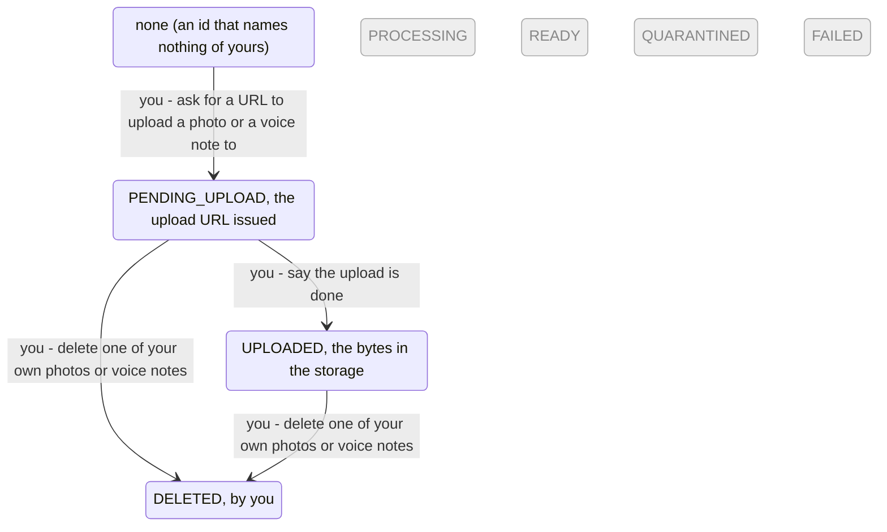

<!-- Generated by scripts/state-map-generate from docs/state-map/data. Do not edit. -->

# The media machine

Describes `main @ 5839d47`. How to read this: [README](README.md).

Every answer of every endpoint, with its cause and how to try it: [endpoints](endpoints.md)

Each region below has its own diagram. Each arrow says who acts: you, your partner or the system. Refusals are not drawn; they are in the tables. Grey means designed or only partly built, and no endpoint reaches it.

## The photo or voice note (one asset, named by its id; only the person who uploaded it can reach it by its id)

### Every action in every state

| Action | `NONE` | `PENDING_UPLOAD` | `UPLOADED` | `DELETED` |
|---|---|---|---|---|
| ask for a URL to upload a photo or a voice note to `POST /media/upload-intent` | 201 → `PENDING_UPLOAD` (the declaration is accepted and a storage is configured) 415 `MEDIA_TYPE_UNSUPPORTED` (the content type is not one its kind takes) 413 `MEDIA_QUOTA_EXCEEDED` (the declared size is over its kind's limit) 503 `MEDIA_STORAGE_UNAVAILABLE` (no storage is configured) | not reachable | not reachable | not reachable |
| say the upload is done `POST /media/{mediaId}/complete` | 404 `NOT_FOUND` | 200 → `UPLOADED` (the storage holds the declared bytes under the asset's key) 409 `MEDIA_NOT_UPLOADED` (the storage holds nothing under the asset's key, or not the declared length and digest) 503 `MEDIA_STORAGE_UNAVAILABLE` (the storage cannot be reached) | 200 stays | 404 `NOT_FOUND` |
| read one of your own photos or voice notes `GET /media/{mediaId}` | 404 `NOT_FOUND` | 200 stays | 200 stays | 404 `NOT_FOUND` |
| delete one of your own photos or voice notes `DELETE /media/{mediaId}` | 404 `NOT_FOUND` | 204 → `DELETED` | 204 → `DELETED` | 404 `NOT_FOUND` |

### You can

| In | Action | When | Leads to | Why | Evidence |
|---|---|---|---|---|---|
| `NONE` | ask for a URL to upload a photo or a voice note to | the declaration is accepted and a storage is configured | `PENDING_UPLOAD` | A new asset waits for its upload, and you get a URL that takes exactly the declared bytes straight to the storage, never through the API, for 15 minutes, with the headers the upload must carry. The URL is signed for the content type, the length and the SHA-256, so the storage refuses any other body. | smoke |
| `PENDING_UPLOAD` | say the upload is done | the storage holds the declared bytes under the asset's key | `UPLOADED` | The storage holds the declared length (and the declared SHA-256, where the storage reports one), so the asset is uploaded and MediaUploaded is recorded for the pipeline, in one transaction. | smoke |
| `UPLOADED` | say the upload is done |  | stays | It is already complete. Completing again, under the same key or a new one, changes nothing and records no second event; the same key is answered as a replay. | test |
| `PENDING_UPLOAD` | read one of your own photos or voice notes |  | stays | Its kind, status, type and size. No URL: nothing is ready to be shown until the pipeline (D2) makes it so. | smoke |
| `UPLOADED` | read one of your own photos or voice notes |  | stays | Its kind, status, type and size. No URL until the pipeline (D2) has made its variants. | smoke |
| `PENDING_UPLOAD` | delete one of your own photos or voice notes |  | `DELETED` | The asset is deleted, and after the commit whatever was uploaded under its key is removed from the storage. Nothing can be attached to an entry yet (D2), so every asset of yours can be deleted. | test |
| `UPLOADED` | delete one of your own photos or voice notes |  | `DELETED` | The asset is deleted, and after the commit its object is removed from the storage. If the storage cannot be reached then, the bucket's lifecycle rule removes the upload within two days. | smoke |

### Refused here

| In | Action | When | Answer | Why | Rule | Evidence |
|---|---|---|---|---|---|---|
| `NONE` | ask for a URL to upload a photo or a voice note to | the content type is not one its kind takes | 415 `MEDIA_TYPE_UNSUPPORTED` | An image is JPEG, PNG, HEIC or WebP; a voice note is MPEG-4 audio, Ogg, AMR, WebM or WAV. A type with parameters is refused too, because the value is signed and must be sent back exactly. Nothing is recorded. | FR-042, ADR-0047 §1 | smoke |
| `NONE` | ask for a URL to upload a photo or a voice note to | the declared size is over its kind's limit | 413 `MEDIA_QUOTA_EXCEEDED` | More bytes than the kind allows: 10 MB for an image, 5 MB for a voice note. It refuses the upload, never an entry. Nothing is recorded. | FR-042, FR-043, doc 06:186 | smoke |
| `NONE` | ask for a URL to upload a photo or a voice note to | no storage is configured | 503 `MEDIA_STORAGE_UNAVAILABLE` | No storage is configured: production, until the owner makes the bucket. Signing an upload URL needs no network, so a configured storage that is down does not refuse an intent; the completion does. Nothing is recorded; keep the entry's words and offer the photo again later. | ADR-0047 §5 | test |
| `NONE` | say the upload is done |  | 404 `NOT_FOUND` | Nothing of yours has this id: another person's photo, an id that names nothing and a value that is not an id all get this one answer, never 403, so that it does not confirm the asset exists. A partner reaches media only through an entry, never by its id. | doc 06:182-184, ADR-0047 §3 | test |
| `PENDING_UPLOAD` | say the upload is done | the storage holds nothing under the asset's key, or not the declared length and digest | 409 `MEDIA_NOT_UPLOADED` | Nothing has been uploaded under the URL yet, or not the bytes declared. Nothing changes and the key is not recorded: finish the upload (the URL works until its expiresAt), then complete again. | ADR-0047 §2 | smoke |
| `PENDING_UPLOAD` | say the upload is done | the storage cannot be reached | 503 `MEDIA_STORAGE_UNAVAILABLE` | The storage did not answer within 3 s (two attempts of 1.5 s). It is asked before any transaction opens, so nothing was locked or recorded meanwhile, the Idempotency-Key included; complete again later. | ADR-0047 §2 | test |
| `DELETED` | say the upload is done |  | 404 `NOT_FOUND` | You deleted it. A deleted asset is gone to its owner too, and answers as one that never existed. | doc 06:184, ADR-0047 §3 | test |
| `NONE` | read one of your own photos or voice notes |  | 404 `NOT_FOUND` | Nothing of yours has this id: another person's photo, an id that names nothing and a value that is not an id all get this one answer, never 403, so that it does not confirm the asset exists. A partner reaches media only through an entry, never by its id. | doc 06:183, BR-1, ADR-0047 §3 | smoke |
| `DELETED` | read one of your own photos or voice notes |  | 404 `NOT_FOUND` | You deleted it. A deleted asset is gone to its owner too, and answers as one that never existed. | doc 06:184 | smoke |
| `NONE` | delete one of your own photos or voice notes |  | 404 `NOT_FOUND` | Nothing of yours has this id: another person's photo, an id that names nothing and a value that is not an id all get this one answer, never 403, so that it does not confirm the asset exists. A partner reaches media only through an entry, never by its id. | doc 06:184, ADR-0047 §3 | smoke |
| `DELETED` | delete one of your own photos or voice notes |  | 404 `NOT_FOUND` | You deleted it. A deleted asset is gone to its owner too, and answers as one that never existed. | doc 06:184 | test |
